<div align="center">

# Stockwise

**Inventory management for a trading business with two godowns: sales, purchases, stock and reports in one connected workflow.**

Next.js 16 · React 19 · Tailwind CSS 4 · TypeScript · Vitest

**[Live demo →](https://YOUR-VERCEL-URL.vercel.app)**  ·  No login needed  ·  Sample data loads automatically

<br />

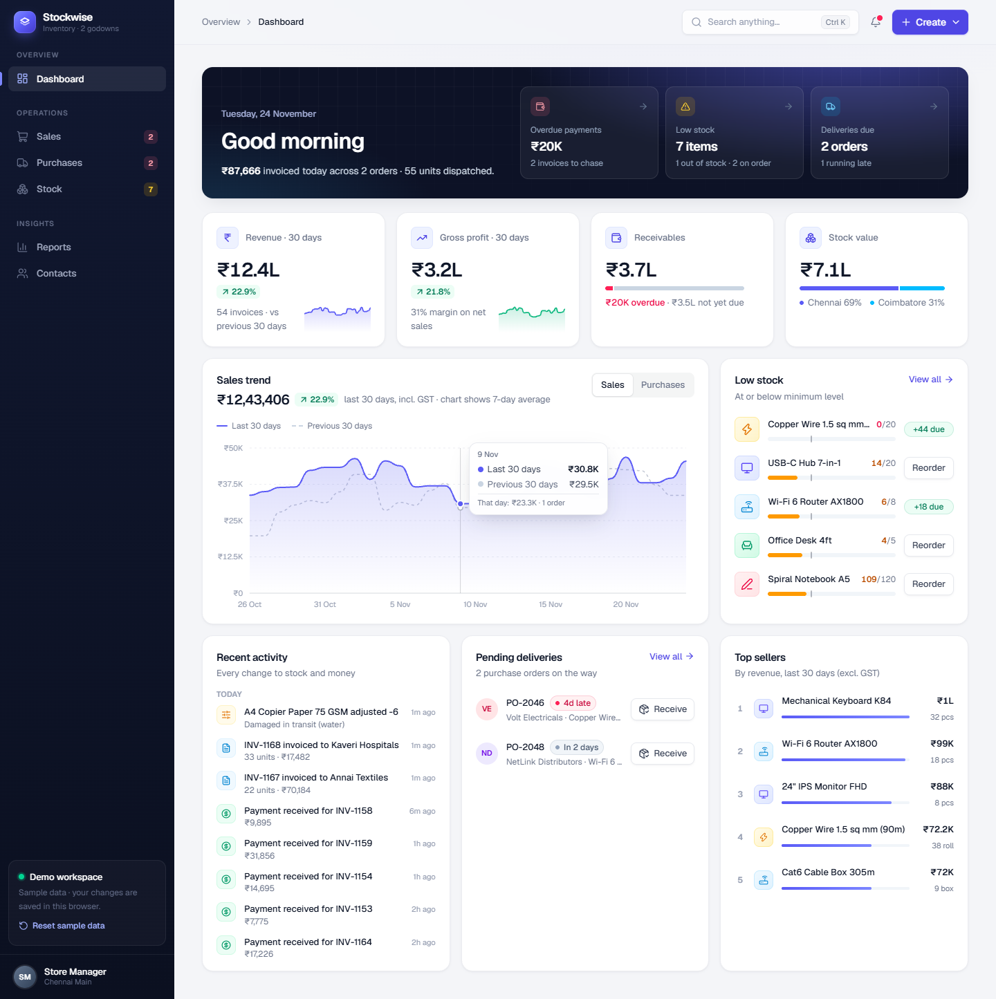

</div>

---

## Contents

- [The workflow in 30 seconds](#the-workflow-in-30-seconds)
- [Modules](#modules)
- [How everything connects](#how-everything-connects)
- [Design decisions](#design-decisions)
- [Architecture](#architecture)
- [Quality checks](#quality-checks)
- [Run it locally](#run-it-locally)

---

## The workflow in 30 seconds

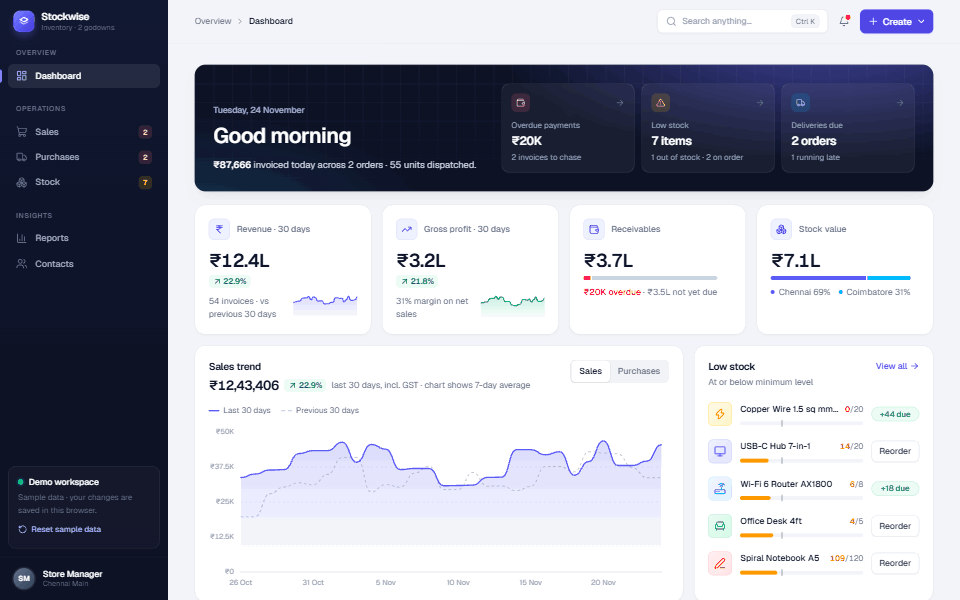

1. The dashboard flags **low stock**, and **Reorder** opens a purchase order with the supplier, a suggested quantity and the last rate filled in.
2. **Receiving** the order adds the stock. The stock history shows the movement, linked to the PO.
3. A **sale** deducts stock. If an item drops below its minimum, the confirmation says so, and the dashboard and sidebar update instantly.

---

## Modules

### Dashboard
A dark summary banner shows today's invoicing and the three things that need attention (overdue payments, low stock, deliveries due), each one click from the filtered list. Below it:
- KPI tiles: revenue and gross profit with trend sparklines and change against the previous 30 days, receivables split by overdue, and stock value split by godown.
- A sales and purchase trend chart compared with the previous period, with a hover tooltip.
- Low stock with one-click reorder, pending deliveries you can receive in place, recent activity grouped by day, and top sellers.

### Sales
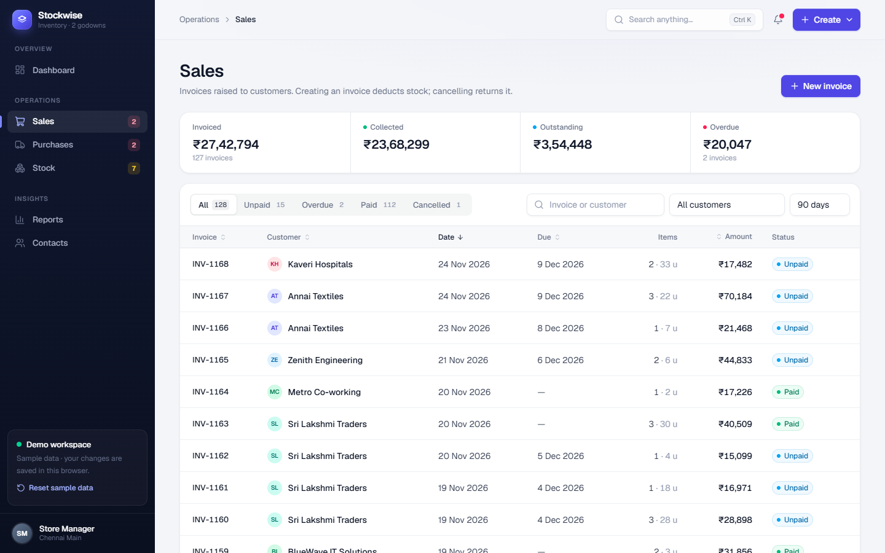

- Invoices with status tabs (all, unpaid, overdue, paid, cancelled), search, a customer filter and a period filter. A summary strip shows invoiced, collected, outstanding and overdue amounts.
- Each invoice opens in a side panel with line items, GST, a timeline, **Mark as paid**, **Cancel** (returns stock) and **Print**, which prints a clean tax invoice.

| Invoice | New invoice with a stock check |
|---|---|
| 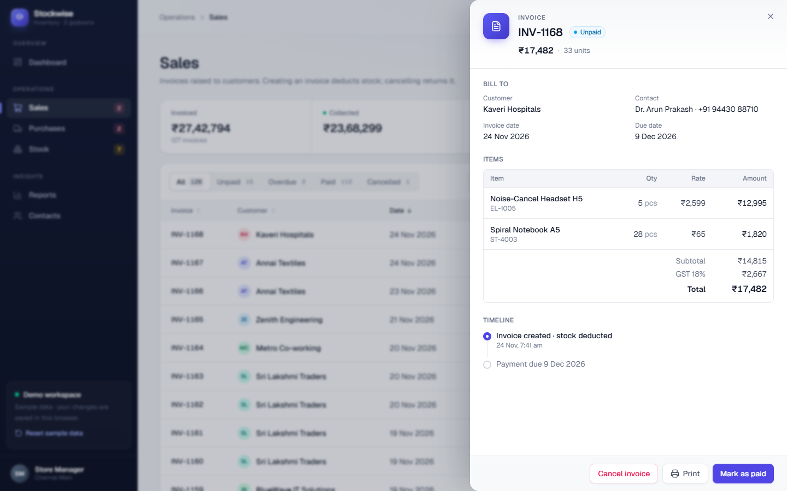 | 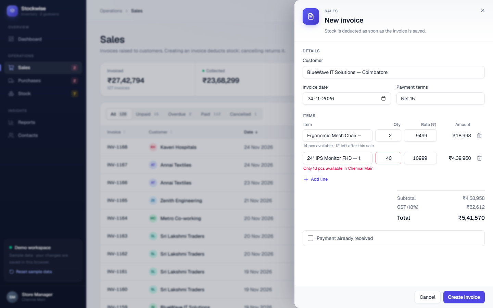 |

The invoice form shows the stock available for every line and blocks overselling ("Only 13 pcs available in Chennai Main").

### Purchase
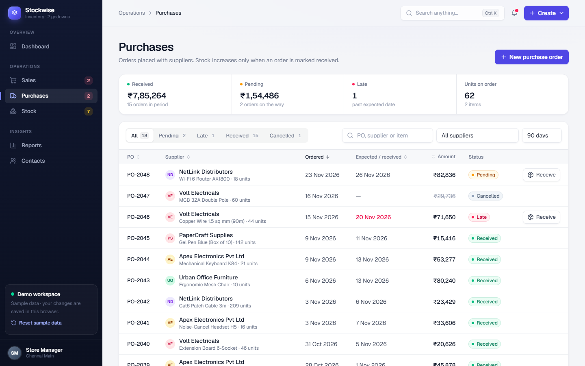

- Purchase orders with pending, **late**, received and cancelled tabs, plus supplier and period filters.
- **Receive** works straight from the list, the dashboard or the order itself. Stock only changes when goods are received.

### Stock, godowns and history
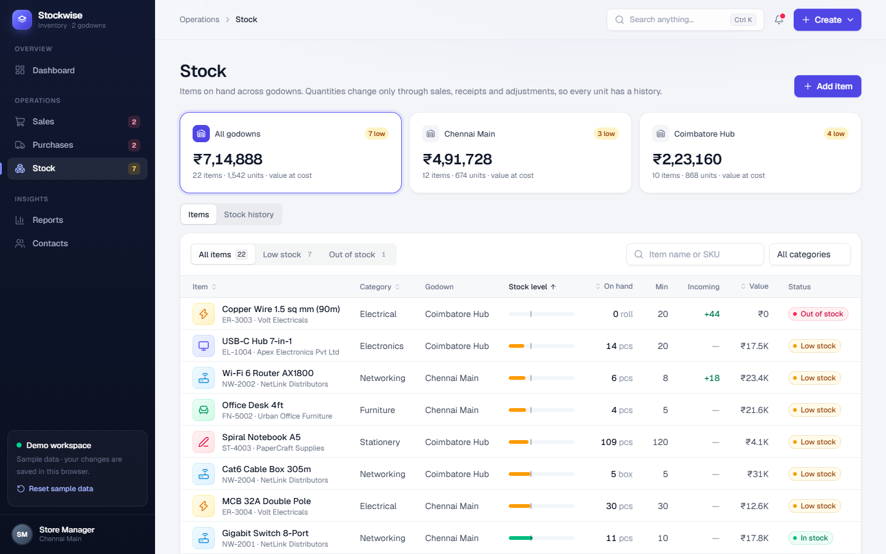

- **Godown view:** cards for Chennai Main and Coimbatore Hub filter the whole page.
- Every item shows a stock-level bar against its minimum, units incoming on open POs, value and status. You can filter by low or out of stock, category and search.
- The **item panel** shows on-hand, incoming and sold quantities, days of cover, margin, open orders and the item's full **stock history** with running balances. Edit, Adjust, Sell and Reorder are one click away.

| Item detail | Stock history ledger |
|---|---|
| 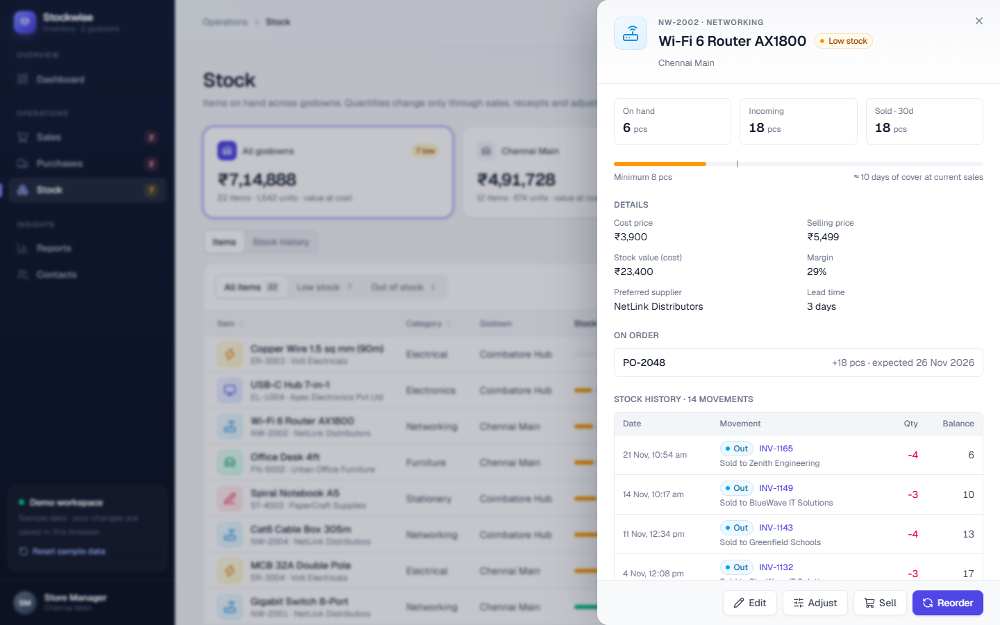 | 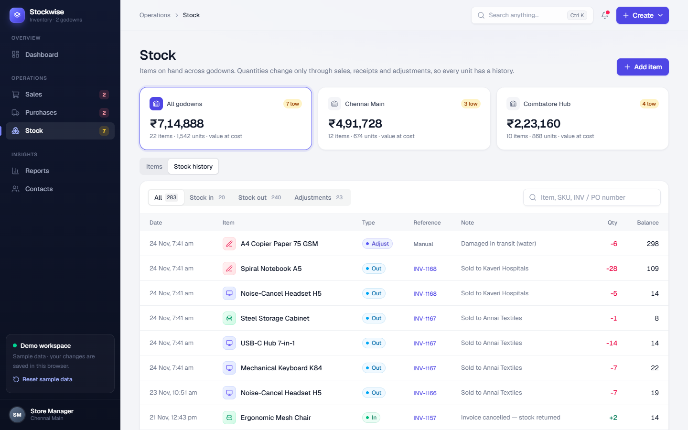 |

### Reports
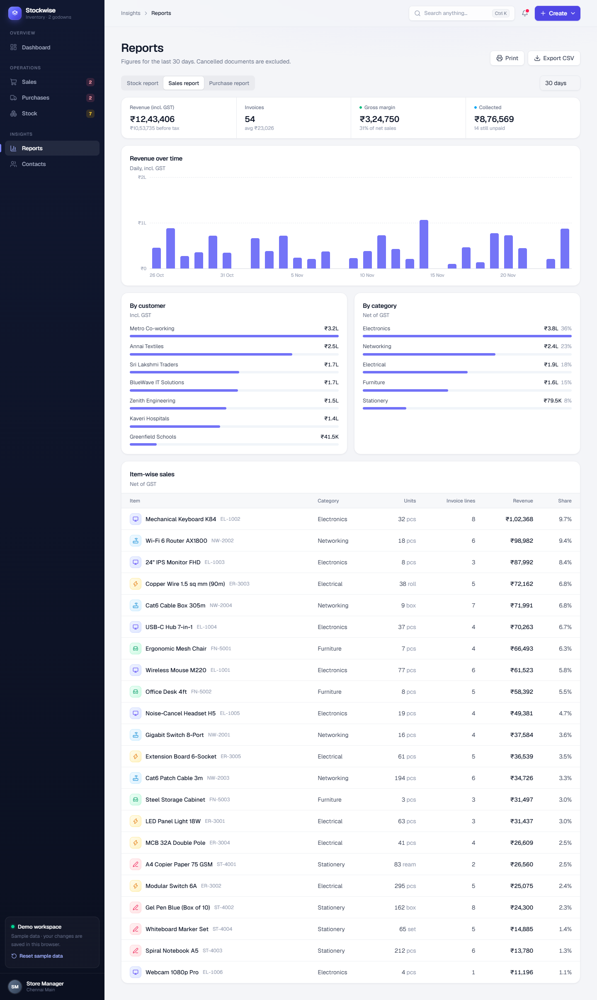

- **Stock report:** valuation by category and godown, retail value and potential margin, and days of cover per item.
- **Sales report:** revenue trend, gross margin, breakdowns by customer and category, and item-wise sales.
- **Purchase report:** spend trend and supplier performance (average lead time compared with the quoted lead time, and on-time rate).
- Every report has a period filter, **CSV export** and print.

### Contacts and global search
| Contacts | Ctrl/⌘ K search |
|---|---|
| 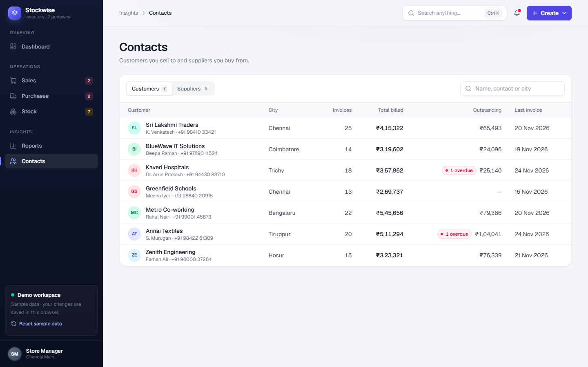 | 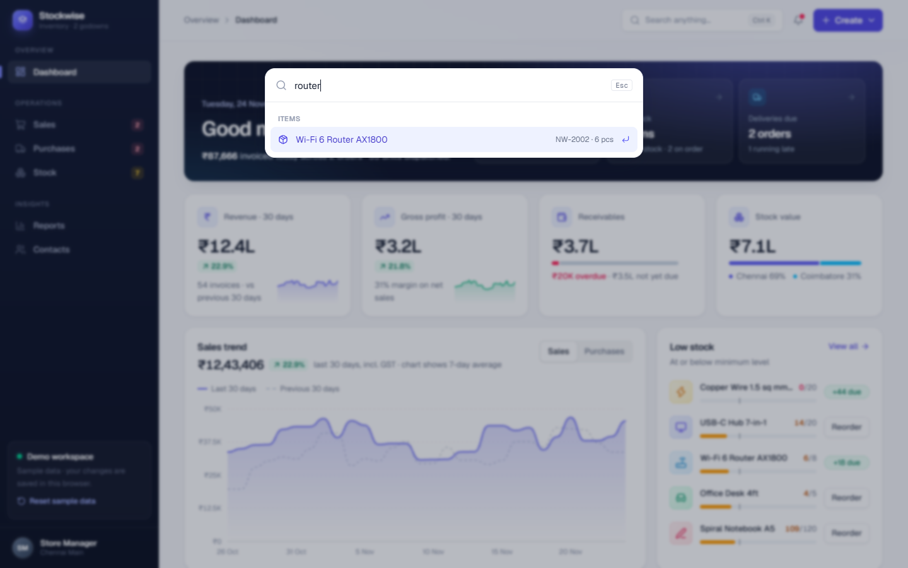 |

The alerts bell in the top bar lists everything that needs attention:

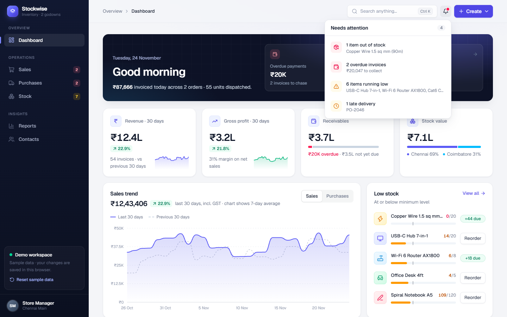

### On a phone
| Dashboard | Menu | Stock |
|---|---|---|
| 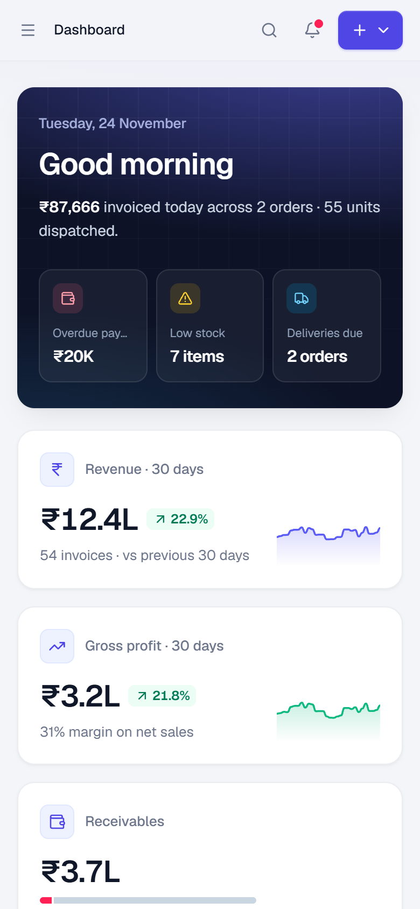 | 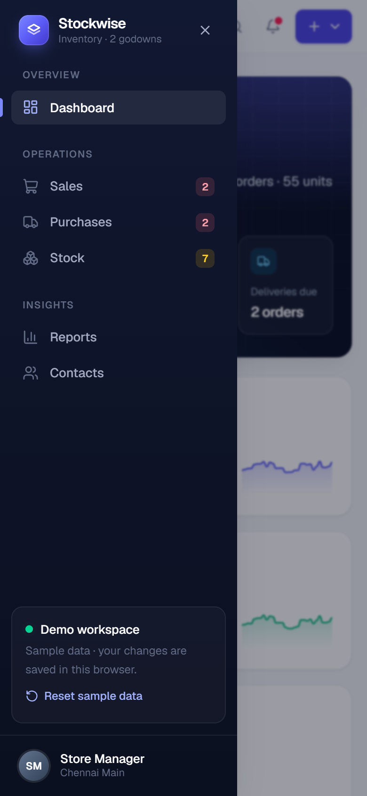 | 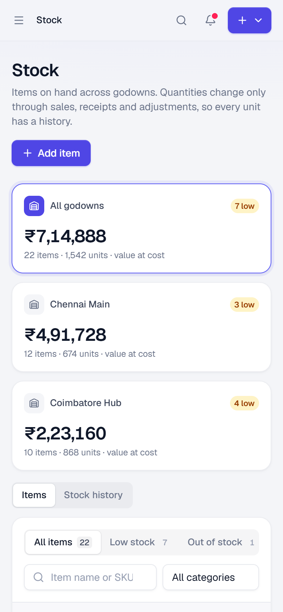 |

---

## How everything connects

| You do this | Stockwise does this |
|---|---|
| **Create an invoice** | Deducts stock and logs an `OUT` movement for each line. It refuses to sell more than is on hand. If an item crosses its minimum, the confirmation links to the low-stock list. |
| **Cancel an invoice** | Returns every unit to stock with an `IN` movement. |
| **Raise a purchase order** | Leaves stock as it is. The units show as **Incoming** on the item. |
| **Mark a PO received** | Adds stock, and the purchase rate becomes the item's cost. |
| **Adjust stock** | Records damage, a recount or a customer return, always with a reason, as an `ADJUST` movement. |
| **Anything above** | Updates the dashboard, the sidebar badges, the alerts bell, the stock history, the activity feed and the reports, all at once. |

Every movement's reference (INV-…, PO-…) links back to the document that caused it.

---

## Design decisions

- **Records open in a side panel, not a new page**, so your list, search, filters and scroll position stay put. Panels stack: *Item → Reorder → Back* returns you to the item.
- **Filters live in the URL** (`/stock?status=low`, `/reports?tab=sales&period=90d`). Every dashboard tile links to a filtered view, and the browser's back button works as expected.
- **Insight before data.** The dashboard leads with what needs action and ends with the detail.
- **Visual identity in the data:** category-tinted item thumbnails, initials avatars for customers and suppliers, and tabular numbers so columns line up.
- **No browser pop-ups.** Destructive actions use a two-step confirm button, errors appear inline next to the form, and every action gets a toast with a link to its result.
- **Trends are smoothed honestly.** The dashboard charts a 7-day rolling average, labelled as such, and the tooltip still shows the actual day's total.
- **Works at phone width:** the sidebar becomes a slide-over menu, the top bar condenses, and wide tables scroll inside their cards.

---

## Architecture

```
src/
├─ lib/
│  ├─ inventory.ts      The engine: one pure apply(state, action) function. All business rules live here.
│  ├─ inventory.test.ts Tests for every rule and invariant
│  ├─ seed.ts           Builds 75 days of history by replaying actions through the engine
│  ├─ store.tsx         React context around the engine; saves to localStorage
│  ├─ analytics.ts      Read-only figures for the dashboard and reports
│  └─ use-url-state.ts  Filters kept in the URL
├─ components/
│  ├─ ui/               Design system: button, badge, card, field, table, drawer, toast, avatar
│  ├─ charts/           Area chart, column chart, sparkline, bar list (plain SVG, no chart library)
│  ├─ forms/            Invoice, purchase order, item and adjustment forms
│  ├─ drawers/          Invoice, PO, item and contact panels
│  ├─ shell/            Sidebar, top bar, alerts, Create menu, panel stack, command palette
│  └─ views/            One component per page
└─ app/                 Routes. Each page just renders its view.
```

**One source of truth.** The UI never edits stock directly; it sends an action such as `{ type: "purchase/receive", id }` to `apply()`. That function validates the action and returns the next state, with stock, history and the activity feed updated together. Nothing can drift out of sync.

**The sample data is real history.** `seed.ts` doesn't hard-code stock levels. It replays about 75 days of sales, purchases, receipts, payments and exceptions through the same engine. Every quantity, history row and report figure is therefore consistent with the documents behind it.

**Lean dependencies:** Next.js, React, Tailwind, `lucide-react` icons, `clsx` and `tailwind-merge`. Charts are hand-written SVG.

---

## Quality checks

```bash
npm test        # Vitest: 25 tests for the engine and the sample data
npm run lint    # ESLint (Next.js + React Compiler rules): no warnings
npm run build   # Type-checked production build, all routes prerendered
```

The tests check that:
- stock always equals the sum of its movements, every running balance is correct, and stock never goes negative;
- sales deduct stock, cancelling returns it, purchase orders only add stock when received, and adjustments are recorded;
- validation blocks overselling, empty or zero-quantity lines, duplicate lines, negative rates, duplicate SKUs and invalid edits;
- `apply()` never mutates its input, and the sample data is deterministic, never future-dated and in true time order.

The app was also exercised end to end in a real browser: every page, both workflows above, printing, and phone width. There were no console errors.

---

## Run it locally

```bash
npm install
npm run dev            # http://localhost:3000
```

Use **Reset sample data** in the sidebar to start over. Changes are saved in your browser only.

### Deploy

Import the repository at [vercel.com/new](https://vercel.com/new). No environment variables or extra settings are needed.
